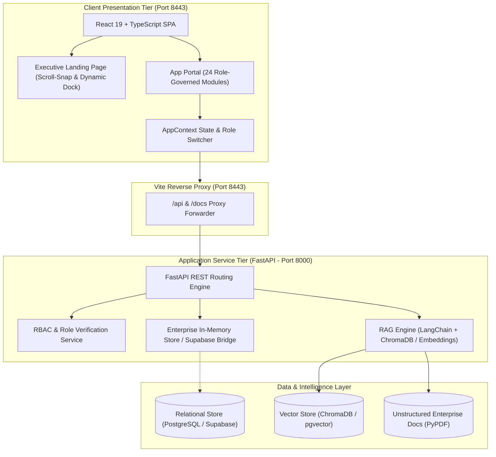

# BizNexus — Intelligent Enterprise Business Platform

<div align="center">


**An AI-driven, unified CRM + ERP + Supply Chain + Finance + Document Intelligence SaaS platform engineered for modern commercial enterprises.**

</div>

---

### 🎓 Academic & Institutional Reference
- **Project Group**: BE_A12
- **Faculty Guide**: Prof. Sonal Jain
- **Target SDG**: UN SDG 9 — *Industry, Innovation and Infrastructure*
- **Engineering Team**:
  - **Anupras Davane** (23104174)
  - **Anurag Gupta** (23104024)
  - **Jayesh Gupta** (23104219)
  - **Ayush Bhunya** (23104013)

---

## 🏛️ System Architecture



---

## 🛠️ Technology Stack

| Layer | Component | Description & Role |
| :--- | :--- | :--- |
| **Frontend** | React 19, TypeScript, Vite | Modern component tree with declarative state management |
| **Styling** | Tailwind CSS v4, Lucide Icons | Custom luxury palette: Off-White Cream, Chocolate Brown & Burnished Amber |
| **Data Visualization** | Recharts | Interactive financial, sales pipeline, and inventory metrics |
| **Backend API** | FastAPI, Python 3.12, Uvicorn | High-throughput asynchronous REST services and OpenAPI documentation |
| **Data Modeling** | Pydantic v2 | Strict schema validation and data transfer objects (DTOs) |
| **AI / RAG Core** | LangChain, PyPDF, ChromaDB | Semantic document chunking, vector indexing, and grounded citation Q&A |
| **Database** | PostgreSQL / Supabase | Relational data architecture with multi-tenant Row-Level Security (RLS) |
| **Reverse Proxy** | Vite Proxy (`http://localhost:8443`) | Unified origin serving frontend SPA, backend `/api`, and Swagger `/docs` |

---

## ✅ Things Done (Current Progress & Features Implemented)

### 1. 🎨 Executive Landing Experience
- **Smooth Scroll-to-Snap**: Native CSS scroll snapping across all viewport sections with smooth trackpad and mousewheel inertia deceleration (`scroll-snap-stop: normal`).
- **Dynamic Glassmorphic Navigation & Dock**:
  - Top header features a frosted glass aesthetic at scroll position 0.
  - Automatically transitions smoothly into a left-side floating chocolate glass navigation dock when scrolling down past 110px.
  - Returns smoothly to the top bar when returning up (with hysteresis buffer at 60px to prevent boundary jitter).
- **Executive Design System**:
  - Curated high-contrast palette: **Off-White Cream** (`#FAF7F2`, `#F5EFEB`), **Rich Chocolate** (`#5C3A21`), **Deep Espresso** (`#1A0F08`), and **Burnished Amber/Copper** (`#D97706`).
  - Professional enterprise word framing (Unified Commercial Architecture, Decision Intelligence Core, Deterministic Tenant Isolation).
  - Cleaned of generic clichés and replaced with professional Lucide iconography (`BrainCircuit`, `Cpu`, `Network`, `FileSearch`, `Compass`, `Fingerprint`, `ShieldCheck`).

### 2. 🛡️ Role-Based Access Control (RBAC) & Governance Engine
- **8 Predefined Enterprise Personas**:
  1. *Business Owner / Executive* (Unrestricted omni-access & executive analytics)
  2. *Sales Manager* (Pipeline governance, deal approvals, quota metrics)
  3. *Sales Executive* (Lead capture, customer communications, order creation)
  4. *Marketing Manager* (Campaign tracking, multi-channel social performance)
  5. *Inventory Manager* (SKU catalogues, stock adjustments, warehouse management)
  6. *Purchase Manager* (Vendor directories, purchase orders, PO approvals)
  7. *Finance Manager* (Accounts receivable/payable, invoice reconciliations, expenses)
  8. *Business Analyst* (Read-only data intelligence and commercial reports)
- **Individual User Override Engine**:
  - Supports the **Authority Equation**:  
    $$\text{Effective Permissions} = \text{Role Permissions} \cup \text{Individual User Overrides}$$
  - Allows granting granular capabilities (e.g., customer export rights) to specific users without modifying company-wide role structures.
- **Interactive Role Switcher**: Topbar persona selector for instant preview of dynamic route filtering and UI privilege changes.

### 3. 💼 Unified CRM & Customer Lifecycle
- **Lead Pipeline**: Kanban drag-and-drop & list view with stage progression (New, Contacted, Qualified, Proposal, Won, Lost).
- **Lead 360° Profile**: Activity log, deal metrics, contact cards, and conversation notes.
- **B2B Accounts Directory**: Master customer accounts with credit terms, total revenue, open orders, and contact directory.
- **Customer 360° View**: Unified overview of historical purchases, outstanding invoices, and communication history.

### 4. 📦 ERP, Supply Chain & Inventory
- **Sales Orders & Quotations**: Comprehensive order tracking with fulfillment workflows, itemized pricing, and shipping statuses.
- **Unified Inventory**: Multi-warehouse stock tracking, SKU management, low-stock threshold triggers, and real-time valuation.
- **Purchasing & Vendors**: Vendor directory with performance metrics, purchase requisition orders, and receiving workflows.

### 5. 💳 Financial Operations
- **Invoices & Billing**: Automated invoice generation, status lifecycle (Draft, Sent, Paid, Overdue), and payment reminders.
- **Payment Reconciliation**: Payment record ledger supporting bank transfers, cards, and credit accounts.
- **Expense Tracking**: Operational expense reporting categorized by department and fiscal period.

### 6. 🧠 Document Intelligence & RAG Core
- **Enterprise Knowledge Base**: Repository for company contracts, product specifications, and regulatory manuals.
- **RAG Architecture Visualization**: Interactive visual breakdown of the document ingestion pipeline (Upload → Extraction → Chunking → Embeddings → Vector Database → Semantic Retrieval).
- **BizNexus AI Assistant**: Grounded natural language query engine that quotes exact document excerpts and database records with interactive citations.

### 7. 🔌 Full-Stack Integration & Proxy Architecture
- **Vite Reverse Proxy**: Configured under `http://localhost:8443/` forwarding `/api`, `/docs`, and `/openapi.json` to FastAPI backend running on port 8000.
- **FastAPI Endpoints**:
  - `/api/health` — Service readiness probe
  - `/api/dashboard` — Role-specific KPI metrics and chart feeds
  - `/api/crm/leads` & `/api/crm/customers` — Account and lead endpoints
  - `/api/erp/orders` & `/api/erp/inventory` — Supply chain data routes
  - `/api/rag/query` — Document intelligence query service
  - `/api/rbac/roles` & `/api/rbac/permissions` — Access control directory
  - Interactive Swagger UI served at `http://localhost:8443/docs`.

---

## 🎯 Upcoming Scopes & Roadmap

```
[Phase 1: Persistent DB & Auth] ──> [Phase 2: Self-Serve Onboarding] ──> [Phase 3: Production RAG & pgvector] ──> [Phase 4: Integrations] ──> [Phase 5: Cloud Deployment]
```

### Phase 1: Real Database Persistence & Supabase Auth 🗄️
- [ ] **Supabase PostgreSQL Integration**: Migrate from mock in-memory stores to hosted PostgreSQL schemas with relational foreign keys.
- [ ] **Row-Level Security (RLS)**: Enforce multi-tenant cryptographic isolation at the database layer using `tenant_id` claims inside JWT tokens.
- [ ] **Production Authentication**: Implement secure JWT authentication, session refresh tokens, password hashing (Argon2/bcrypt), and magic link verification.

### Phase 2: Tenant Self-Service Onboarding & Organization Provisioning 🏢
- [ ] **Sign-Up & Workspace Wizard (`/signup`)**: Interactive flow for new companies to register their organization, select their commercial domain slug, and designate the initial Owner.
- [ ] **Modular Provisioning**: Allow companies to toggle specific modules on/off (e.g., Enable CRM & Inventory while disabling Marketing Campaigns).
- [ ] **Team Invitations**: Generate one-time invite tokens allowing administrators to invite employees with predefined RBAC roles.

### Phase 3: Production Vector Pipeline & Hybrid Search 🔍
- [ ] **Live PDF Vector Ingestion**: Support drag-and-drop PDF upload with background task extraction using PyPDF / Unstructured.
- [ ] **Vector Storage with pgvector / ChromaDB**: Generate 1536-dimensional embeddings (`text-embedding-3-small` or Sentence Transformers `all-MiniLM-L6-v2`) and store them with tenant-isolated metadata.
- [ ] **Hybrid Search & Exact Citations**: Combine BM25 keyword matching with dense vector similarity search to deliver sub-second document answers with clickable page and paragraph citations.
- [ ] **SQL Query Agent**: LangChain SQL agent enabling natural language querying directly against business database tables (e.g., *"Show top 5 customers with overdue invoices in Q3"*).

### Phase 4: Third-Party Integrations & Automation Webhooks 🔗
- [ ] **Payment Gateway Webhooks**: Stripe / Razorpay webhooks for instant invoice reconciliation and receipt generation.
- [ ] **Transactional Email**: Integrate Resend / SendGrid for automated customer quotation emails, payment receipts, and low-stock alerts.
- [ ] **Export & Accounting**: One-click export to CSV/Excel and integration with standard accounting software (Tally / QuickBooks).

### Phase 5: Containerization & Cloud CI/CD 🚀
- [ ] **Docker & Docker Compose**: Unified `docker-compose.yml` orchestrating the React frontend, FastAPI backend, and local PostgreSQL/pgvector instance.
- [ ] **CI/CD Automation**: GitHub Actions workflow running TypeScript linting, Python unit tests (`pytest`), and container builds on every pull request.
- [ ] **Cloud Deployment**: Production deployment strategy (Frontend on Vercel / Cloudflare Pages, Backend on AWS ECS / Render / Railway).

---

## 📁 Repository Directory Layout

```
BizNexus/
├── .gitignore                    # Root gitignore (Python, Node, Vite, env, OS, PDFs)
├── README.md                     # Comprehensive documentation & roadmap
│
├── frontend/                     # React 19 + TypeScript + Vite Application
│   ├── src/
│   │   ├── components/           # Reusable UI cards, tables, topbar & navigation
│   │   ├── context/
│   │   │   └── AppContext.tsx    # Role switching & RBAC state provider
│   │   ├── data/
│   │   │   └── mockData.ts       # Comprehensive enterprise mock datasets
│   │   ├── pages/                # 24 Functional & Visual Pages
│   │   │   ├── Landing.tsx       # Scroll-snap executive landing page & dynamic dock
│   │   │   ├── Dashboard.tsx     # Role-adaptive KPI dashboard
│   │   │   ├── LeadsPipeline.tsx # Leads Kanban board & table
│   │   │   ├── LeadDetail.tsx    # Lead 360° detail view
│   │   │   ├── Customers.tsx     # Master B2B customer directory
│   │   │   ├── CustomerDetail.tsx# Customer account history & orders
│   │   │   ├── SalesOrders.tsx   # Sales orders & fulfillment tracking
│   │   │   ├── Inventory.tsx     # SKU directory & warehouse tracking
│   │   │   ├── Documents.tsx     # Document knowledge base & RAG pipeline
│   │   │   ├── AIAssistant.tsx   # Enterprise AI with citations
│   │   │   ├── UsersRoles.tsx    # RBAC permission matrix & user overrides
│   │   │   └── ...               # Finance, Marketing, Purchases, Settings
│   │   ├── routes.ts             # React Router configuration
│   │   └── main.tsx              # React entry point
│   ├── package.json
│   └── vite.config.ts            # Vite config with reverse-proxy on port 8443
│
└── backend/                      # Python + FastAPI Enterprise Service
    ├── app/
    │   ├── api/
    │   │   └── routes.py         # REST endpoints (Dashboard, CRM, ERP, RAG, RBAC)
    │   ├── core/
    │   │   └── config.py         # Application configuration
    │   ├── models/
    │   │   └── schemas.py        # Pydantic schemas and DTOs
    │   └── services/
    │       ├── mock_db.py        # Enterprise mock data repository
    │       └── rag_service.py    # LangChain & vector search service
    ├── requirements.txt          # Python dependencies
    └── main.py                   # FastAPI server entry point (Port 8000)
```

---

## ⚡ Local Setup & Execution Guide

### Prerequisites
- **Node.js**: v18.0.0 or higher
- **npm**: v9.0.0 or higher
- **Python**: v3.11 or v3.12
- **Git**

---

### Step 1: Clone the Repository
```bash
git clone https://github.com/JayeshGupta0/BizNexus.git
cd BizNexus
```

---

### Step 2: Start the Backend Service (FastAPI)

```bash
cd backend

# Create and activate a Python virtual environment
python -m venv venv

# On Windows (PowerShell):
.\venv\Scripts\Activate.ps1
# On macOS / Linux:
# source venv/bin/activate

# Install dependencies
pip install -r requirements.txt

# Run the FastAPI service on port 8000
python -m uvicorn main:app --reload --port 8000
```

- API Base URL: **`http://localhost:8000`**
- Interactive Swagger Documentation: **`http://localhost:8000/docs`**
- Health Probe: **`http://localhost:8000/api/health`**

---

### Step 3: Start the Frontend Application (React + Vite)

In a new terminal window:

```bash
cd frontend

# Install Node dependencies
npm install

# Start Vite development server (configured on port 8443)
npm run dev
```

- Unified Application URL: **`http://localhost:8443/`**
- Proxied Swagger Docs: **`http://localhost:8443/docs`**
- Proxied Health Probe: **`http://localhost:8443/api/health`**

---

## 🚀 Pushing to GitHub

To push this repository to your GitHub account:

```bash
# 1. Initialize git in the root folder (if not already done)
git init

# 2. Stage all files
git add .

# 3. Create your initial commit
git commit -m "feat: initial commit of BizNexus enterprise platform with dynamic landing, RBAC, and full module suite"

# 4. Set default branch to main
git branch -M main

# 5. Link your GitHub remote repository
git remote add origin https://github.com/JayeshGupta0/BizNexus.git

# 6. Push to GitHub
git push -u origin main
```

---

## 📄 License
This project is licensed under the MIT License — see the [LICENSE](LICENSE) file for details.
